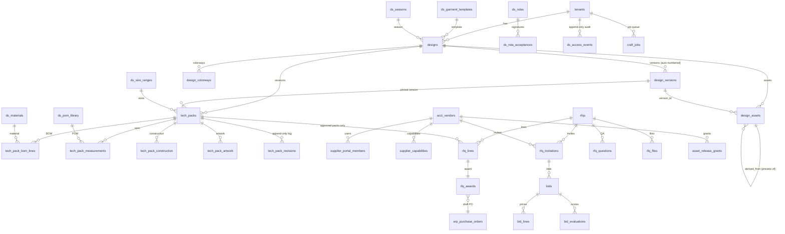

# 02 — Database (S590 + S600)

Files: `db/S590_design_studio_prereq_fixes.sql`, `db/S600_design_studio_production.sql`, `db/S605_browser_runner.sql`,
`db/S600_tests.sql`, `db/S605_tests.sql`.
Copy them to `supabase/migrations/` (timestamped names, same order) and `supabase/tests/`.
Both migrations are idempotent and were applied twice in a row on a full copy of your 31-domain schema; the test suite
passes 82/82.

## How it fits your schema
- Step ledger: S600 calls `unify.done('600')` (S590 → `'590'`), so it slots in after S500.
- Canonical vendor is **`acct_vendors`** (per `platform_canonical_map`); every supplier FK points there. POs reuse
  `erp_purchase_orders` / `erp_purchase_order_lines` and `erp_next_document_number(tenant,'rfq'|'purchase_order')`.
- Notifications reuse `platform_notify(...)` (in-app + your existing channels; FCM is added as a channel in T27).
- RLS reuses the registry: `platform_classify_tables` + `platform__apply_app_security()`. S600 adds 12 rows to
  `platform_table_access_overrides` (explicit `tenant_read`/`tenant_admin`), keeps its own `ds_*` sealed-bid
  policies on the inferred tables `bids`, `bid_lines`, `bid_evaluations`, and re-applies security at the end.
  Re-running the registry keeps the `ds_*` policies (verified).

## Baseline bugs fixed in S590
| Bug | Fix |
|---|---|
| `platform_admins.user_id` FK pointed at `portal_users(id)` → nobody could be made platform admin | FK → `auth.users(id)` |
| Duplicate FKs on `design_files` (`fk_design_files_design_id`) and `design_publications` (2 duplicates) | dropped duplicates |
| `design_assets.tenant_id` and `projects.tenant_id` nullable → rows invisible to RLS / cross-tenant risk | backfill from parent, then `SET NOT NULL` |
| No `updated_at` triggers on `designs`, `projects`, `design_assets` | `set_updated_at()` triggers |

## ERD (new tables + the existing ones they hang off)


## Table catalog
Access mode: **member** = registry `app_member_*` (read/write for tenant members); **read** = members read, writes only
through RPCs/service role; **admin** = owners/admins write; **sealed** = custom `ds_*` policies.

| Table | Mode | Purpose / key rules |
|---|---|---|
| `ds_seasons` | member | SS27/FW27; unique (tenant, code) |
| `ds_size_ranges` | member | `sizes text[]`, `base_size ∈ sizes`, unit cm/in |
| `ds_pom_library` | member | points of measure + default tolerances |
| `ds_materials` | member | fabrics/trims with gsm, composition, certifications, nominated vendor |
| `ds_garment_templates` | member | print areas (normalized x/y/w/h + mm), flat/pattern/GLB assets, turntable frame count; S610 adds parametric `block`, `license_id`, `license_scope` |
| `ds_asset_licenses` (S610) | admin | license record for every flat / mockup / model; decides supplier visibility |
| `designs` (extended) | member | + `season_id`, `garment_template_id`, `style_number` (unique per tenant), `current_version_id`, `deleted_at`; `source` now includes every Craft app |
| `design_versions` | read | write only via `ds_create_design_version`; number auto-assigned under an advisory lock; locked on tech-pack approval (immutable, even for service role) |
| `design_assets` (extended) | member | + `classification` (internal / supplier_preview / production_release / supplier_upload) with a bucket-match CHECK; previews must reference `derived_from_asset_id` |
| `design_colorways` | member | colorway names, hex, Pantone |
| `supplier_portal_members` | read | invite token stored only as SHA-256; token is single-use, 7-day expiry, bound to the invited email |
| `supplier_capabilities` | member | category, techniques, MOQ, lead time, certifications, lat/long (Maps) |
| `ds_ndas` | admin | versioned; text immutable; `body_sha256` set by trigger; one active per tenant |
| `ds_nda_acceptances` | read, append-only | signer, exact hash, IP, UA |
| `tech_packs` | member | revisioned per design; status via RPC only; children frozen unless draft/in_review; delete only never-reviewed drafts |
| `tech_pack_bom_lines` / `_measurements` / `_construction` / `_artwork` | member | measurement size must exist in the size range |
| `tech_pack_revisions` | read, append-only | full JSON snapshot at each transition |
| `rfqs` | member | status via RPC only; editable only while draft |
| `rfq_lines` | member | approved tech packs only (checked at publish); `target_unit_cost` never leaves to suppliers; frozen after publish |
| `rfq_invitations` | read | one per vendor; status machine |
| `rfq_questions` | read | private Q&A, optional anonymized broadcast |
| `bids` / `bid_lines` | sealed | supplier writes only via `supplier_*`; staff read only when unsealed; total maintained by trigger; one live bid per vendor |
| `bid_evaluations` | sealed | each evaluator writes their own score after unseal |
| `rfq_awards` | read | one award per RFQ line; links PO |
| `rfq_files` | read | supplier uploads (100 MB max, MIME allowlist) + virus-scan status |
| `asset_release_grants` | read | `preview` (during RFQ) / `production` (after award) per vendor × tech pack |
| `ds_access_events` | read, append-only | audit trail (23 event types) |
| `craft_jobs` | read | queue; `SKIP LOCKED` claims, heartbeats, retries with exponential backoff, idempotency key |

## Trigger catalog
| Trigger function | On | Does |
|---|---|---|
| `ds__match_parent_tenant(parent_table, fk_col)` | every child table | sets/validates `tenant_id` from the parent; blocks cross-tenant rows |
| `ds__status_guard(initial)` | tech_packs, rfqs, bids, rfq_invitations | status must start at `initial`; changes only when `ds.via_rpc='on'` (set transaction-locally by RPCs) |
| `ds__version_before_insert` / `_after_insert` / `ds__version_lock_guard` | design_versions | number, set current, lock immutability |
| `ds__tp_child_guard` | tech pack children | frozen unless parent draft/in_review |
| `ds__tp_delete_guard` | tech_packs | only never-reviewed drafts deletable |
| `ds__measurement_size_guard` | tech_pack_measurements | size ∈ size range |
| `ds__rfq_edit_guard` / `ds__rfq_child_guard` | rfqs / rfq_lines | frozen after publish |
| `ds__bid_total` | bid_lines | recompute `bids.total_amount` |
| `ds__nda_immutable` | ds_ndas | hash on insert, immutable text, no delete |
| `ds__append_only` | revisions, NDA acceptances, access events | blocks UPDATE/DELETE for everyone |
| `set_updated_at` | all mutable tables | timestamps |

## RPC catalog
Staff RPCs check `platform_is_tenant_member` (or `_admin` where noted). Supplier RPCs check the supplier gate chain.
Worker RPCs are `service_role` only. `ds__*` helpers are internal (not executable by `authenticated`).

| RPC | Caller | Returns | Notes |
|---|---|---|---|
| `ds_create_design_version(design, canvas_state, source_app, document_asset, preview_asset, message, sha256)` | member | uuid | updates `designs.canvas_state` |
| `ds_create_tech_pack(design, title, version, size_range, base_size)` | member | uuid | clones children from previous revision; one open revision at a time |
| `ds_transition_tech_pack(tp, to, note)` | member; **admin** for approved/released/archived | tech_packs | validates completeness; locks version; snapshots; queues PDF jobs |
| `ds_tech_pack_snapshot(tp)` | member | jsonb | used for PDF rendering and diffs |
| `ds_create_rfq(tenant, title, deadline, currency, incoterm, sealed)` | member | uuid | attaches the active NDA |
| `ds_invite_vendor_to_rfq(rfq, vendor)` | member | uuid | creates preview grants |
| `ds_publish_rfq(rfq)` | **admin** | rfqs | NDA, deadline ≥ 1h, lines, approved packs with previews, ≥1 invite |
| `ds_close_rfq(rfq)` | **admin** or cron | rfqs | drops never-submitted drafts |
| `ds_close_due_rfqs()` | service (pg_cron, every minute) | int | |
| `ds_answer_question(q, answer, broadcast)` | member | void | notifies asker or all invitees |
| `ds_award_rfq(rfq, [{rfq_line_id, bid_id}])` | **admin** | jsonb `{purchase_orders:{vendor:po}}` | draft POs, production grants, revokes losers |
| `ds_invite_supplier_user(vendor, email, role, name)` | **admin** | jsonb `{member_id, token}` | token shown once; server emails it |
| `ds_revoke_supplier(vendor, reason)` | **admin** | void | kills membership, invites, grants |
| `ds_enqueue_job(tenant, kind, app, input, subject_type, subject, key, priority)` | member | uuid | idempotent |
| `ds_rfq_unsealed(rfq)`, `ds_my_vendor_ids()` | policy helpers | | |
| `supplier_accept_invite(token)` | signed-in supplier | jsonb | email must match |
| `supplier_get_nda(rfq)` / `supplier_accept_nda(rfq, sha256, name, title)` | supplier | | hash must equal the text shown |
| `supplier_my_rfqs()` | supplier | jsonb | |
| `supplier_get_rfq(rfq)` | supplier + NDA | jsonb | minimised payload (no target cost, no paths, no competitors) |
| `supplier_authorize_asset_view(rfq, asset)` | supplier + NDA | jsonb `{allowed, bucket, path, watermark_text, ttl_seconds}` | called **only** by the proxy route; denial returns `allowed:false` and is logged |
| `supplier_save_bid(rfq, payload)` / `supplier_submit_bid(bid)` / `supplier_withdraw_bid(bid)` | supplier (not viewer role) | | revisions allowed if RFQ allows |
| `supplier_ask_question(rfq, text)` / `supplier_decline_rfq(rfq, reason)` | supplier | | |
| `supplier_register_upload(rfq, name, mime, size)` | supplier | jsonb `{rfq_file_id, bucket, path}` | server signs the upload URL; queues virus scan |
| `supplier_authorize_release(tech_pack)` | awarded supplier | jsonb `{allowed, bucket, path…}` | production pack after award |
| `ds_claim_jobs(worker, kinds, limit)` / `ds_heartbeat_job` / `ds_finish_job` / `ds_reap_stale_jobs` | service | | `finish` wires outputs (PDF ids, scan results); used by the scan-worker |
| `ds_claim_browser_jobs(tenant, session, kinds, limit)` (S605) | tenant member | `SETOF craft_jobs` | own tenant only, `runner='browser'` only, max 5; tags `claimed_by = browser:<uid>:<session>` |
| `ds_heartbeat_browser_job(job, session)` (S605) | claiming tab | boolean | false => job was reaped/cancelled, tab must stop |
| `ds_finish_browser_job(job, session, ok, output, error)` (S605) | claiming tab | `craft_jobs` | rejects other tabs/users and output assets from another tenant; reuses `ds_finish_job` side effects |

## Storage buckets (all private)
| Bucket | Who can read | Path convention |
|---|---|---|
| `design-private` | tenant members (policy `ds_design_private_rw`) | `{tenant_id}/designs/{design_id}/{version_no}/{file}` |
| `supplier-previews` | **nobody directly**; service role via proxy | `{tenant_id}/previews/{design_id}/{asset_id}.{webp,pdf}` |
| `supplier-uploads` | tenant members read; suppliers upload via signed upload URL | `{tenant_id}/{rfq_id}/{vendor_id}/{file_id}-{name}` |
| `production-releases` | **nobody directly**; service role via release route | `{tenant_id}/{tech_pack_id}/{vendor_id}/techpack-r{n}.pdf` |
The existing `design-assets` bucket stays for non-sensitive internal assets; T09 migrates sensitive objects to `design-private`.

## Cron (pg_cron, run once outside the migration)
```sql
SELECT cron.schedule('ds_close_due_rfqs',  '* * * * *',   $$SELECT public.ds_close_due_rfqs()$$);
SELECT cron.schedule('ds_reap_stale_jobs', '*/2 * * * *', $$SELECT public.ds_reap_stale_jobs()$$);
```

## Known edges (documented, intentional)
- `ds.via_rpc` is transaction-local. PostgREST runs one RPC per transaction, so a client can't chain a direct UPDATE
  after an RPC. Don't open multi-statement transactions with user JWTs in app code.
- Append-only tables block `ON DELETE CASCADE` from `tenants`. Tenant offboarding is a deliberate, service-role
  procedure (export → legal hold check → `SET session_replication_role = replica` → delete). Write it as a runbook, not an RPC.
- `asset_release_grants` is unique per (vendor, tech pack, level). If the same tech pack goes out in two RFQs to the same
  vendor, the grant is shared and `rfq_id` points at the latest. Revocation on award only touches grants for that RFQ.
- Denials from the two authorize RPCs return `allowed:false` (not an exception) so the denial log row commits.
  The proxy must map it to HTTP 403.

## S605 — browser runner (WASM-first)
- `craft_jobs.runner text NOT NULL DEFAULT 'browser' CHECK (runner IN ('browser','server'))`, partial index for ready browser jobs.
- Trigger `trg_craft_jobs_runner` (`ds__job_runner`) forces `virus_scan` to `runner='server'` on insert and update, so an untrusted
  supplier upload is never opened in a staff browser before the scan.
- RPCs above; `ds__browser_tag(session)` validates the tab id (`^[A-Za-z0-9_-]{8,64}$`) and builds the claim tag.
- The existing reaper (`ds_reap_stale_jobs`, pg_cron every 2 min) requeues jobs whose tab closed.
- `S605_tests.sql`: 17 checks (runner forcing, supplier / rival tenant / random user / anon can't claim, session validation,
  claim tagging, heartbeat ownership, another staff member can't finish your job, cross-tenant output rejected, finish works,
  closed tab requeued, server RPCs still service-role only).

## S610 — flat library + license guard (to be written in T10b)
Full spec in `08_FLAT_LIBRARY.md §S610`. Summary:
- New table `ds_asset_licenses` (admin mode): source, license type (`owned` / `open_source` / `licensed_commercial` /
  `vendor_restricted`), license URL + proof asset, `allow_supplier_view`, `allow_redistribution`, `restricted_to_vendor_id`, expiry.
- `design_assets.license_id`; `ds_garment_templates.license_id`, `block`, `style_options`, `generator_version`, generated
  `license_scope` (`owned` / `licensed` / `printful_only` / `unlicensed`).
- Guards: supplier previews / production releases can't derive from a non-supplier-viewable license; `ds_publish_rfq` rejects
  `printful_only` / `unlicensed` templates (`DS_LICENSE_BLOCKED`); `supplier_authorize_asset_view` / `supplier_authorize_release` deny and log them.
- Back-fill: the 34 Printful imports get a `vendor_restricted` Printful license ([Printful ToS §4.6](https://www.printful.com/policies/download/terms-of-service)).
- Import tables `ds_flat_import_batches` + `ds_flat_pieces` for the bundle splitter (T10c): each split piece keeps its
  batch's license, needs a reviewer before it becomes a template, and is never served raw to a supplier.
- Step registration: `('610','ds3','S610_flat_library.sql',17)`, `900` moves to 18.

## S615 — 11-page tech pack template (to be written in T13b)
Full spec in `09_TECH_PACK_TEMPLATE.md §S615`. Adds header fields to `tech_packs`, `is_main_fabric` on BOM lines, callout
anchors on construction rows, and new lockable child tables `tech_pack_pom_markers`, `tech_pack_colorway_components`,
`tech_pack_labels`, `tech_pack_hangtags`, `tech_pack_packaging`, plus `ds_tech_pack_templates`. Extends
`ds_tech_pack_snapshot` (existing keys unchanged) and adds `ds_tech_pack_supplier_snapshot` (no unit cost). Step
`('615','ds4','S615_tech_pack_template.sql',18)`, `900` moves to 19.
